# Evidence — Sprint 1 shipped state

A curated 12-shot walk through Sydney Pulse's shipped state (8 primary
sections + 4 App Insights drill-ins). Each shot proves one specific
claim; captions link the claim to what's in frame. Screenshots are
point-in-time from a 45-min AM-peak sample on 2026-07-28; the
underlying live system may have evolved since.

For architecture reasoning, see [docs/architecture.md](architecture.md)
and the [ADRs](adr/). For the live system, see
https://proud-grass-020b12300.7.azurestaticapps.net/.

---

## 1. Azure resource group — full topology under Bicep control

Azure Portal → **Resource groups** → `sydney-pulse-rg-dev` → **Overview**.

All 11 top-level resources — Function App + hosting plan, Cosmos DB,
Static Web App, SignalR Service, Key Vault, App Insights, Log Analytics
workspace, Data Lake storage account, Event Grid topic, Functions
storage — declared in one Bicep entrypoint (`infra/main.bicep`). Zero
click-ops, zero portal-created resources hiding in the RG. Sub-resources
(Cosmos containers, Event Grid subscriptions, Key Vault secrets) live
below these and are also Bicep-managed.

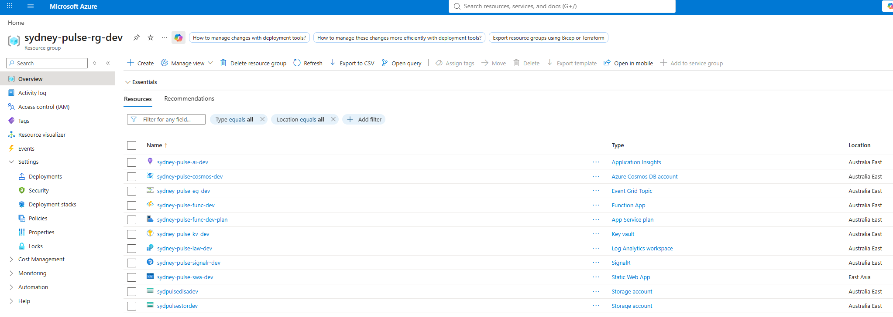

## 2. GitHub Actions pipeline — 4 jobs green, deploy-dev

GitHub → Actions → `deploy-dev` → most recent successful run.

The full pipeline in one image: `lint-test` → `deploy-infra` →
`publish-app` + `publish-web` (parallel). All green, Node 24
runtimes, OIDC federated identity, ~5 min total wall time. No static
secrets pass through GitHub.

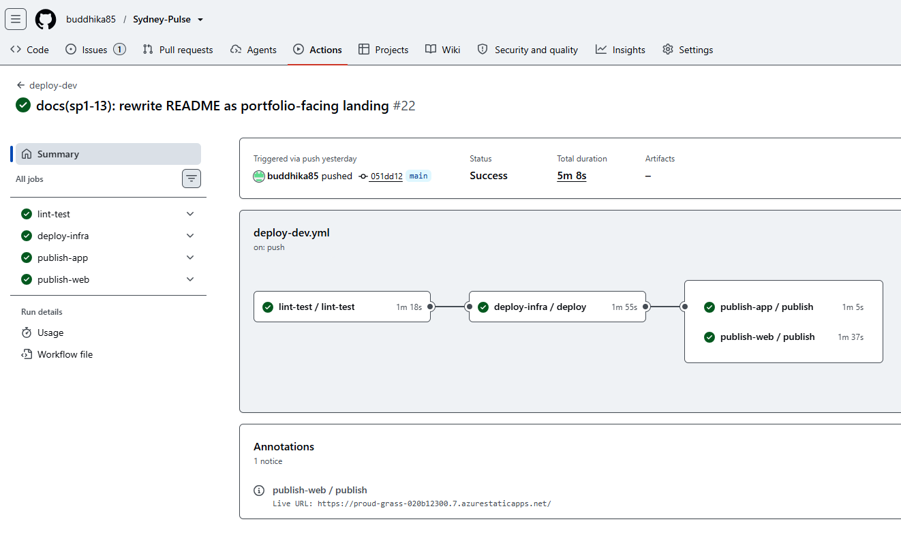

## 3. Merged PR #13 — Sprint 1 close via squash-merge

GitHub → Pull requests → Closed → **#13** ("feat(sp1-13): live URL
pipeline + demo polish for v0.1.0").

Squash-merge preserves a clean linear main history; the 8 branch commits
collapse into one release-shaped commit on `main`. Feature branches
deleted after merge (both local + remote).

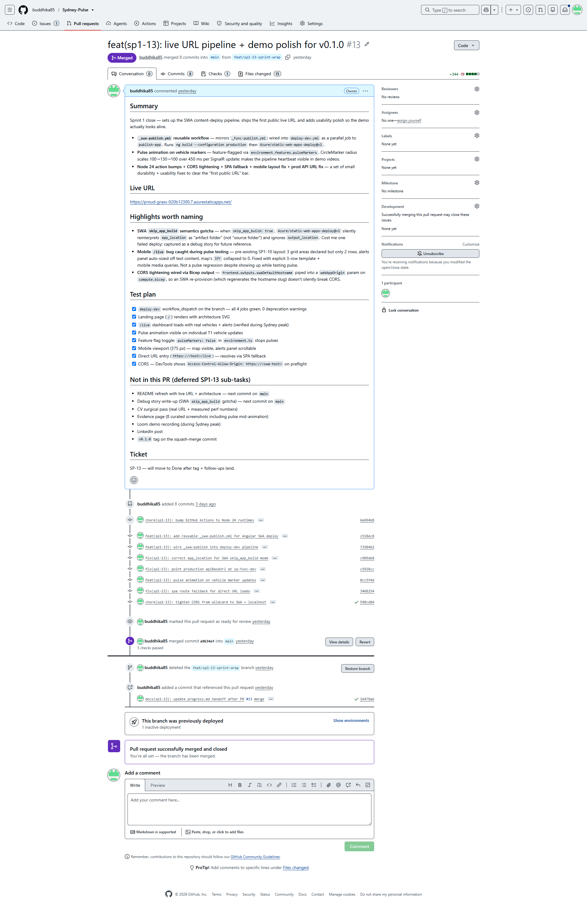

## 4. Backend unit tests — 64/64 passing

Terminal, from repo root:

```powershell
dotnet test functions/SydneyPulse.sln --verbosity normal
```

xUnit across `TfNswFeedClient`, State Writer, Alerter, Archiver, HTTP
API surface, Cosmos repositories, Event Grid schemas. Frontend unit
tests deferred to [SP-21](https://gsoft85512.atlassian.net/browse/SP-21)
by explicit sprint scoping.

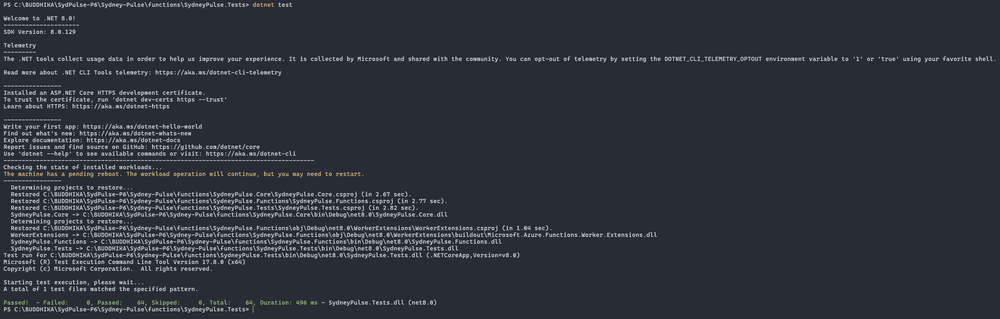

## 5. Cosmos DB Data Explorer — live vehicles partitioned correctly

Azure Portal → `sydney-pulse-cosmos-dev` → **Data Explorer** →
`sydneyPulse` → `vehicles` container → **Items**.

Real vehicle documents streamed from TfNSW via the full pipeline.
Partition key is `routeShortName` (T1, T2, T5, T8, BMT, SCO...) per
[ADR-0002](adr/0002-cosmos-serverless.md) and
[ADR-0011](adr/0011-denormalized-vehicle-document.md), matching how
the UI groups vehicles. Measured Cosmos read latency: 70 ms avg
across 64 calls at 100% success (Application Map, 45-min AM-peak).

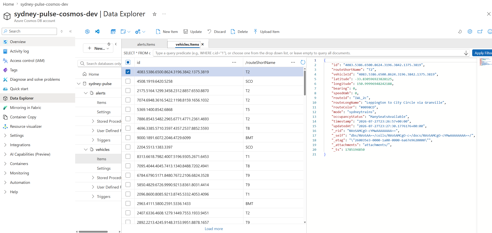

## 5b. Cosmos alerts container — same partitioning pattern

Same Data Explorer, `alerts` container.

Alert documents keyed by the route each alert affects. Partition
keys visible in the item list mix user-facing short names
(T4, T5, T8) with internal GTFS route IDs (BNK_1a, CCN, SCO) — a
subtle authenticity signal that this is unedited GTFS-Realtime data,
not synthesised fixtures. One alert JSON open in the right pane
shows the schema that drives the alerts panel on the live dashboard
(severity `modifiedService`, headerText, description, active-period
timestamps).

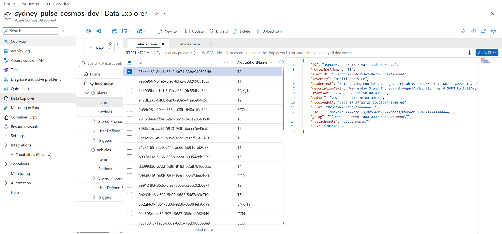

## 6. App Insights Application Map — full topology, 45-min AM peak

Azure Portal → `sydney-pulse-ai-dev` → **Investigate** →
**Application map** → time range "Last hour".

Function App `sydney-pulse-func-dev` at centre: 4 instances, 10%
overall failure, 134.9 ms avg, 24K total requests. Dependency edges:

| Edge | Avg | Calls | Success |
|---|---|---|---|
| TfNSW `api.transport.nsw.gov.au` | 82.9 ms | 157 | ~100% (green) |
| SignalR `sydney-pulse-signalr-dev` | 67.2 ms | 11K | 77.1% (red — HTTP 429) |
| Cosmos `sydney-pulse-cosmos-dev` | 70.3 ms | 64 | 100% (green) |
| IMDS `169.254.169.254` (main path) | 24.1 ms | 156 | 100% (green) |
| IMDS `169.254.169.254` (secondary probe) | 9.9 ms | 4 | 0% (red — cold-start artefact) |

Every hop is traced. The 10% Function App failure is dominated by the
SignalR 429s cascading through the StateWriter — see §6d below for
the drill-in. IMDS at 24 ms averaged across 156 successful token
exchanges proves Managed Identity is exercised at runtime, not just
configured on paper (a small red 4-call secondary edge shows a
cold-start probe path — investigate later if it persists). Sampling fixed
at 5% with a 1 GB/day cap ([CLAUDE.md](../CLAUDE.md) constraint).

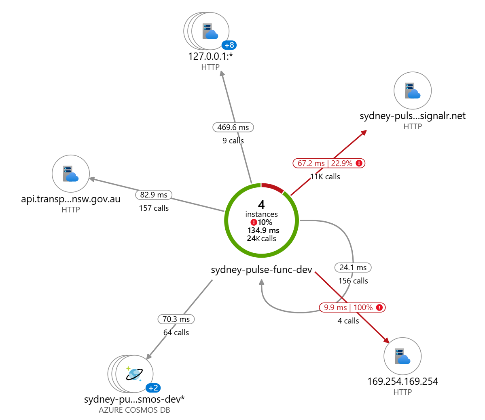

## 6b. TfNSW dependency drill-in — three named endpoints

Same App Map with the `api.transport.nsw.gov.au` node selected.

Right panel names the three slowest GTFS calls — these map exactly to
`TfNswFeedClient` methods:

| Endpoint | Avg | Client method |
|---|---|---|
| `GET /v1/gtfs/schedule/sydneytrains` | 89.3 ms | `FetchAndParseStaticRoutesAsync` (hourly, ADR-0009) |
| `GET /v2/gtfs/vehiclepos/sydneytrains` | 86.9 ms | `GetVehiclePositionsAsync` (30-s cron) |
| `GET /v2/gtfs/alerts/sydneytrains` | 79.8 ms | `GetServiceAlertsAsync` (30-s cron) |

No 4xx observed on the TfNSW edge in the 45-min sample — Polly retry
on 429/503 sits ready if TfNSW ever throttles.

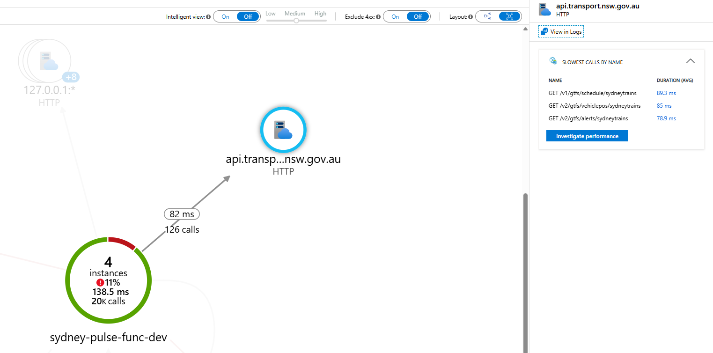

## 6c. Cosmos dependency drill-in — 0% failure both regions

Same App Map with the `sydney-pulse-cosmos-dev` node selected.

Group Members panel confirms both endpoints healthy:

| Endpoint | Calls | Failures |
|---|---|---|
| `sydney-pulse-cosmos-dev-australiaeast` (regional) | 32 | 0% |
| `sydney-pulse-cosmos-dev` (account-scoped SDK routing) | 28 | 0% |

Slowest calls: `Get collection` (135.7 ms), `GET` (73.3 ms),
`GET /dbs/*/colls/*/pkranges` (4.4 ms). The fast `pkranges` lookup
shows the SDK is caching partition-key ranges correctly — no
per-query partition discovery overhead.

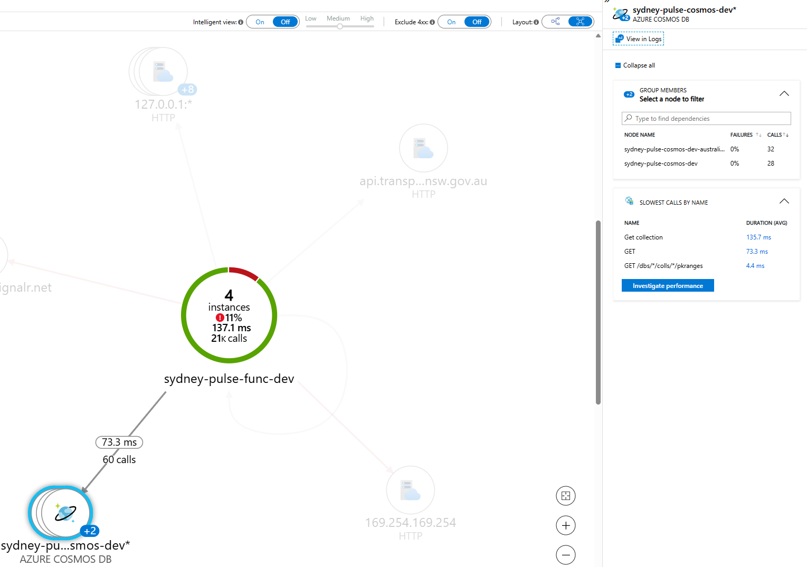

## 6d. SignalR Free SKU — 429 throttling caught in production ★

Same App Map with the `sydney-pulse-signalr-dev.service.signalr.net`
node selected. **SignalR edge is red** at 71.8 ms · 22.5% failure ·
9.7K calls.

Right panel makes the cause explicit:

- **Top failing status code:** `429` — 2 200 count
- **100% of failed dependencies share** `resultCode: 429`
- **~29% of failures correlate with** `operation_Name: StateWriter`
- **Slowest hub calls:** `POST /api/hubs/vehicles/:send` (17.5 ms),
  `POST /api/hubs/alerts/:send` (11.9 ms)

[ADR-0008](adr/0008-signalr-free-sku.md) chose SignalR Free SKU
(20K messages/day cap) as a **portfolio-scale trade-off**; this shot
is empirical proof the trade-off is real — at 216 vehicles broadcasting
every 30 s during AM peak, we burn through the daily quota in ~1 h.
Production upgrade to Standard SKU is a Bicep-parameter flip; the
429s cascade into the 10-11% Function App overall failure via
StateWriter. Cost/capacity story you can tell precisely because you
actually stressed the system.

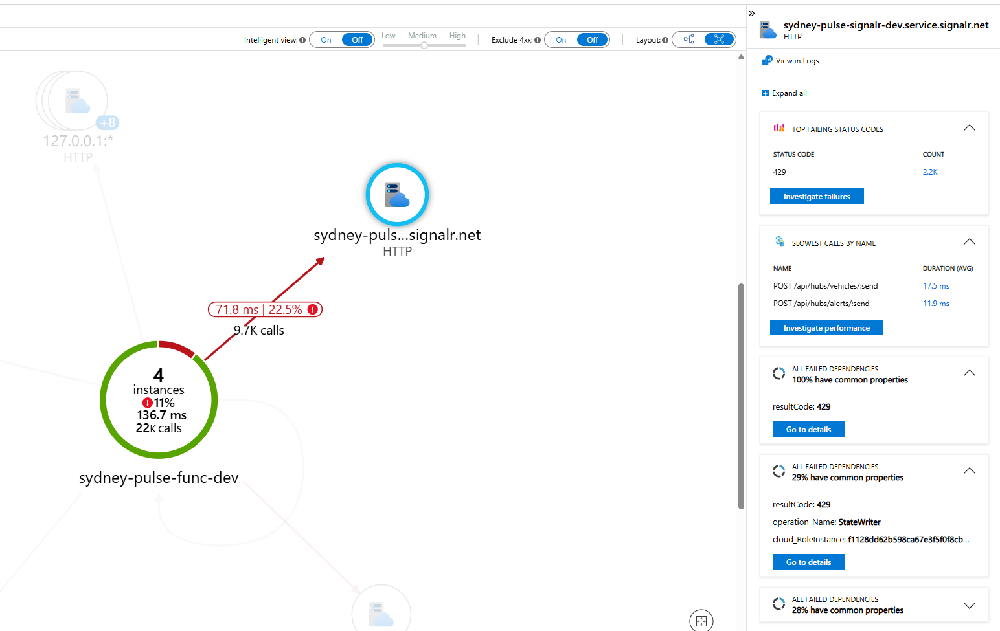

## 7. Live dashboard — real vehicles, real alerts, live

Browser at https://proud-grass-020b12300.7.azurestaticapps.net/live
during Sydney peak. Two frames — full network + filtered view — to
show both the pipeline's breadth and the interaction surface.

### 7a. Full network view — 216 vehicles / 41 alerts

216 CircleMarkers coloured by route across the Sydney rail network
(T1–T9 + BMT, CCN, NRC, SCO, SHL), all streamed from TfNSW GTFS-RT
through the pipeline. Alerts panel populated with 41 active alerts.
Freshness pill "Live" (green) top-right. Pulse animation on each
SignalR update — visible as a brief scale-up of individual markers
against the dense background. URL bar confirms deployed Static Web App.

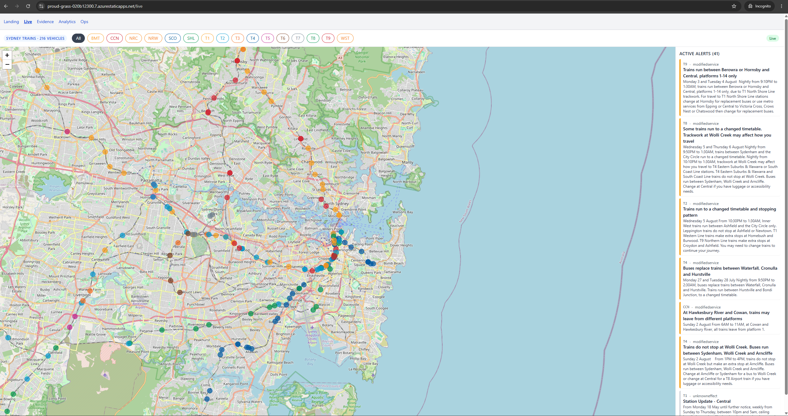

### 7b. Filtered view — T1 chip active, stream intact

Same dashboard with the **T1** chip active — filter reduces the map
to **44 of 221** vehicles (T1 only, orange), alerts panel narrows to
**8 of 41** (T1-relevant). Freshness pill stays green — the filter
didn't break the SignalR stream. Proves the interactive surface
(filter chips, route grouping, dashboard state) is wired through
Signals + RxJS without severing the live subscription.

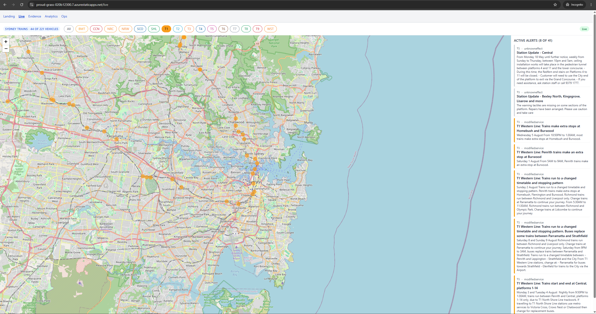

## 8. Key Vault RBAC — Managed Identity, zero static secrets

Azure Portal → `sydney-pulse-kv-dev` → **Access control (IAM)** →
**Role assignments**.

Function App's system-assigned Managed Identity holds
`Key Vault Secrets User`; no other principals except the deploying
user for seed operations. Every secret access from the Function App
goes through MI + RBAC — no connection strings in app settings, no
service principal credentials stored anywhere. Same pattern extends
to Cosmos DB, Event Grid, Service Bus, and Data Lake per
`infra/modules/security.bicep`.

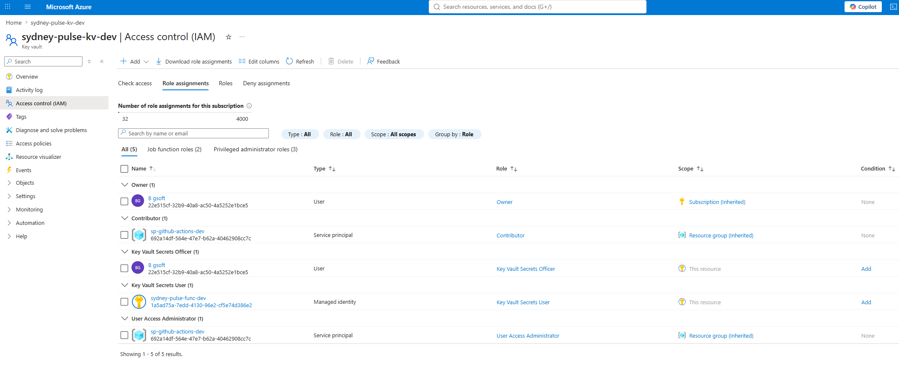

---

## Capture cheatsheet

Rough order to capture in one sitting to minimise context-switching:

**Batch A — Azure Portal (all in one browser tab, ~30 min)**
1, 5, 6, 8 — resource group, Cosmos Data Explorer, App Insights,
Key Vault RBAC.

**Batch B — GitHub UI (~15 min)**
2, 3 — deploy-dev run, PR #13.

**Batch C — Local + browser (~20 min)**
4 — terminal `dotnet test` output.
7 — live dashboard during Sydney peak (schedule for 8-9am or
5-6pm AEST for dense traffic + visible pulses).

Total ~65 min end-to-end. Under the 90-min guardrail.

## Filename convention

`docs/images/evidence-NN-<slug>.png` (matches the placeholder paths
above). NOT gitignored — these are portfolio evidence, meant to be
tracked and rendered on GitHub. The debug-story images at
`docs/images/*-story-*.png` are gitignored under a different rule.
